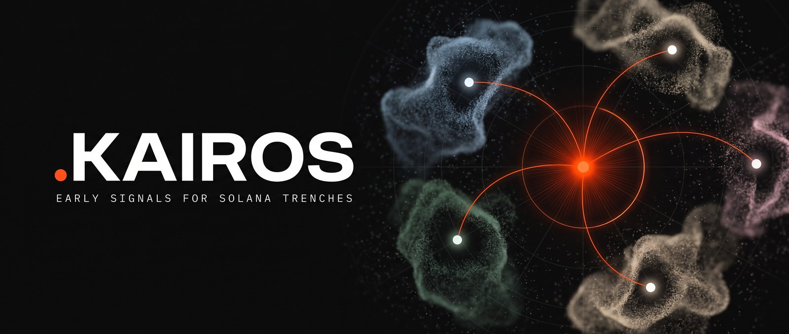
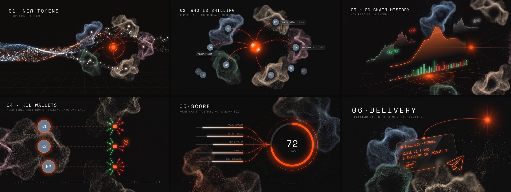
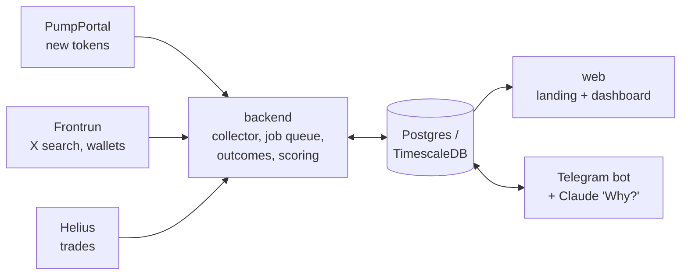

<p align="center">
  
</p>

<p align="center">
  <a href="https://github.com/Premier-lab1/kairos/actions/workflows/ci.yml"></a>
  <a href="LICENSE"></a>
  
  
  
  <a href="https://xkairos.io/app"></a>
</p>

<p align="center">
  <a href="https://xkairos.io">Site</a> ·
  <a href="https://xkairos.io/app">Dashboard</a> ·
  <a href="https://t.me/kairostrench_bot">Telegram bot</a> (closed beta) ·
  <a href="https://x.com/max_reporter">X</a>
</p>

**$KAIROS contract address (Solana)** · [pump.fun](https://pump.fun/coin/Hz721fHpNgsBE7AAoBf4HYgsxm7JXqn39QENUdVopump) · [Solscan](https://solscan.io/token/Hz721fHpNgsBE7AAoBf4HYgsxm7JXqn39QENUdVopump)

```
Hz721fHpNgsBE7AAoBf4HYgsxm7JXqn39QENUdVopump
```

Tokens with the same name can exist on pump.fun; the official one has exactly this address.

# Kairos

Early signals for Solana trenches. Kairos watches new pump.fun tokens, finds which X (Twitter) shillers are already posting the contract address, and checks how those shillers' past calls ended. It does this before the crowd arrives.

> Not financial advice. Kairos shows data and statistics about past behaviour; it does not tell anyone what to buy.

## How it works

[](process)

1. **New tokens.** New pump.fun tokens and migrations stream in for free from PumpPortal.
2. **Who is shilling.** For each token, Kairos searches X for its contract address through the [Frontrun](https://frontrun.pro) API. Every author becomes a tracked shiller with followers, smart followers (SMARTS) and the number of distinct CAs they have posted.
3. **On-chain history.** Trades come from Helius. Outcome labels (success, rug, dead, neutral) are computed from the price path after the first shill. The rules are in [docs/outcomes.md](docs/outcomes.md).
4. **KOL wallets.** Wallets linked to shillers are polled for their own trades. This gives median hold time, fast dumps, and selling after one's own call.
5. **Score.** Rules and statistics, not a black box: each shiller's track record (Wilson lower bound of the win rate), how early the entry was, how many shillers are in, creator history and KOL on-chain behaviour. Every risk is listed next to the score. See [docs/signals.md](docs/signals.md).
6. **Delivery.** A Telegram bot sends signals above a user's threshold, with a "Why?" explanation written by Claude from the signal's facts. The LLM never sets the score.

Each step with its illustration: [process/](process). The same flow as code-level diagrams: [diagrams/](diagrams).

## Calls on the chart

Every avatar is a shiller posting the CA, pinned to the minute of the post. Real tokens from the live dashboard:

[](calls)

| | |
| --- | --- |
| [](calls) | [](calls) |
| **TWYNE** · 45 shillers · peak ×2.8 after the first call | Peak ×2.2, then a collapse of −99% |

More charts with captions: [calls/](calls).

## Dashboard

The dashboard at [xkairos.io/app](https://xkairos.io/app) is open, no login.

| | |
| --- | --- |
| [](showcase) | [](showcase) |
| Token page: KPIs, score, calls on the chart, tweets, KOL buys | Signals feed with score and confidence |
| [](showcase) | [](showcase) |
| Shillers leaderboard | Shiller-to-token graph |

All screenshots, landing and mobile included: [showcase/](showcase). Analytics panels (narratives, shills by hour, mindshare): [analytics/](analytics).

## Architecture



Full diagrams (architecture, pipeline sequence, data model, outcome states): [diagrams/](diagrams).

## Repository

| Folder | What |
| --- | --- |
| [`.github/`](.github) | CI (backend tests on Postgres, web lint and typecheck, schema validation), issue and PR templates, Dependabot |
| [`analytics/`](analytics) | Dashboard analytics panels captured from live data |
| [`assets/`](assets) | Banner, logo, social preview |
| [`backend/`](backend) | Python 3.11 asyncio: collectors, Frontrun/Helius clients, Postgres job queue with daily credit budgets, outcomes, scoring, backtest, Telegram bot (aiogram), LLM explanations. Migrations in `backend/migrations`, tests in `backend/tests` |
| [`backtests/`](backtests) | Walk-forward backtest reports with charts |
| [`calls/`](calls) | Real call charts: market cap with every shiller's post pinned on it |
| [`deploy/`](deploy) | Docker Compose (TimescaleDB, Redis, backend, bot, web, Caddy for HTTPS), backup script, step-by-step server guide |
| [`diagrams/`](diagrams) | Mermaid diagrams: architecture, pipeline, data model, outcomes |
| [`docs/`](docs) | Outcome and scoring rules, Frontrun API notes, design brief |
| [`examples/`](examples) | One real signal end to end: token, call, shiller, signal, outcome, Telegram message |
| [`process/`](process) | The six steps of the pipeline, illustrated |
| [`schemas/`](schemas) | JSON Schemas for the main objects, with a validator |
| [`scripts/`](scripts) | Screenshot capture and backtest chart scripts |
| [`showcase/`](showcase) | Screenshots of the landing page and the dashboard, desktop and mobile |
| [`web/`](web) | Next.js 16 + Tailwind v4: the landing page and the public dashboard (tokens, signals, shillers leaderboard, KOL trades, narratives, logic). Reads Postgres under a read-only role |

Code comments, internal docs and backtest reports are mostly in Russian; the product UI is in English.

## Running locally

Requirements: Python 3.11+, Node 22+, PostgreSQL 16+ (TimescaleDB optional), API keys for Frontrun and Helius.

```bash
cp .env.example .env        # fill in DATABASE_URL, FRONTRUN_API_KEY, HELIUS_API_KEY
cd backend && python -m venv .venv && .venv/bin/pip install -e ".[dev]"
.venv/bin/python -m kairos.db              # applies migrations
.venv/bin/python -m kairos.pipeline.run    # collection, scheduler, workers, outcomes and scoring
```

```bash
cd web && npm install
DATABASE_URL_RO=postgresql://... npm run dev   # http://localhost:3000
```

Details are in [backend/README.md](backend/README.md) and [web/README.md](web/README.md). The production setup (one ARM server, Docker Compose, Caddy) is in [deploy/README.md](deploy/README.md).

Tests need Postgres on port 5434 with a user `kairos` and several `kairos_test_*` databases; [`.github/scripts/create_test_dbs.py`](.github/scripts/create_test_dbs.py) creates them. Then `cd backend && KAIROS_TEST_PG=postgresql://kairos@localhost:5434 python -m pytest`. The CI workflow does exactly this.

## License

[MIT](LICENSE)
