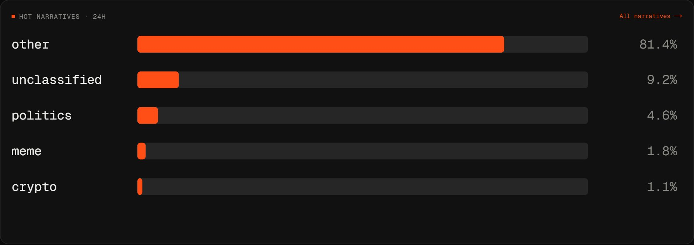
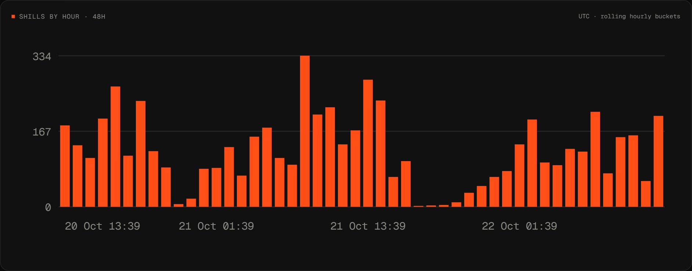
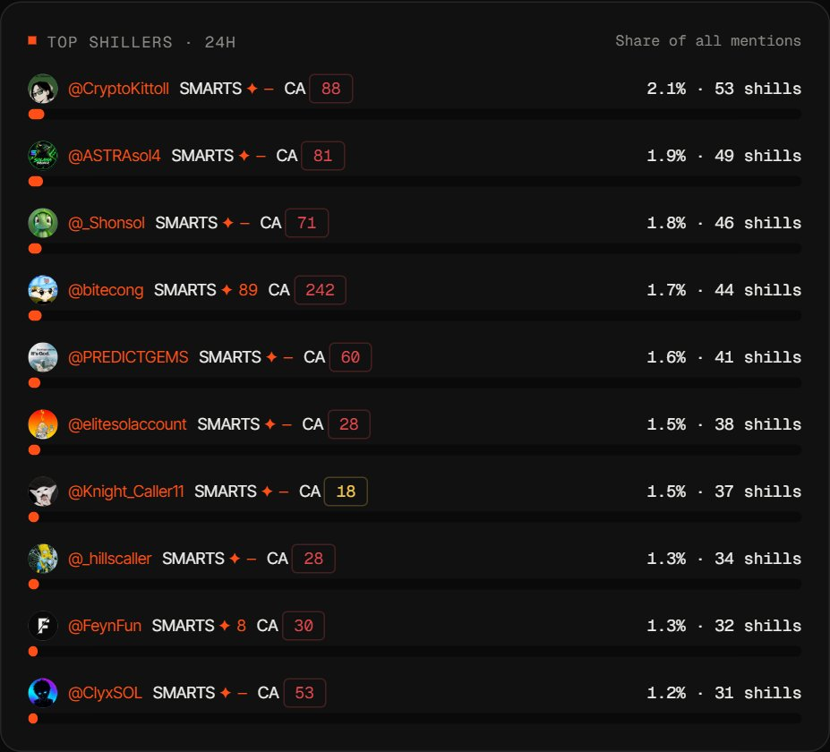
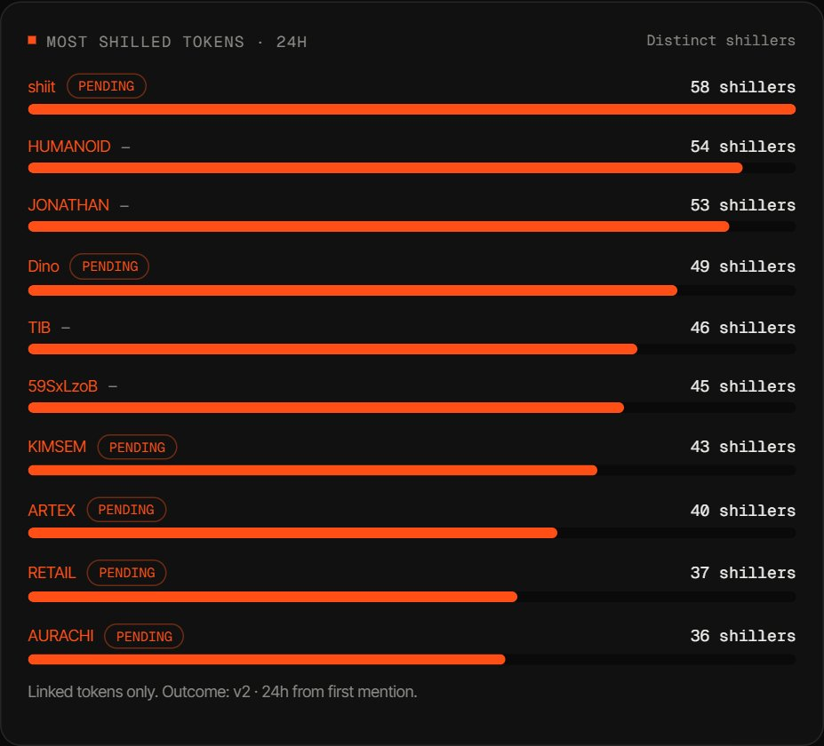
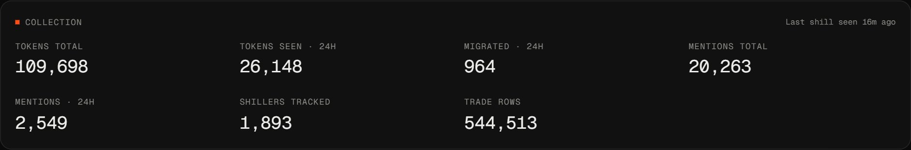
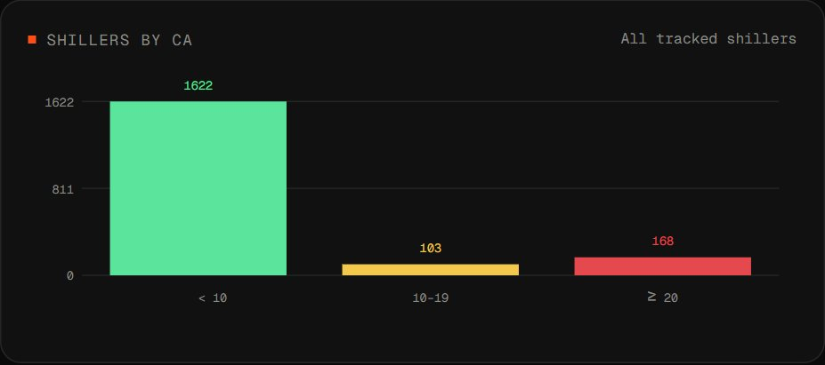
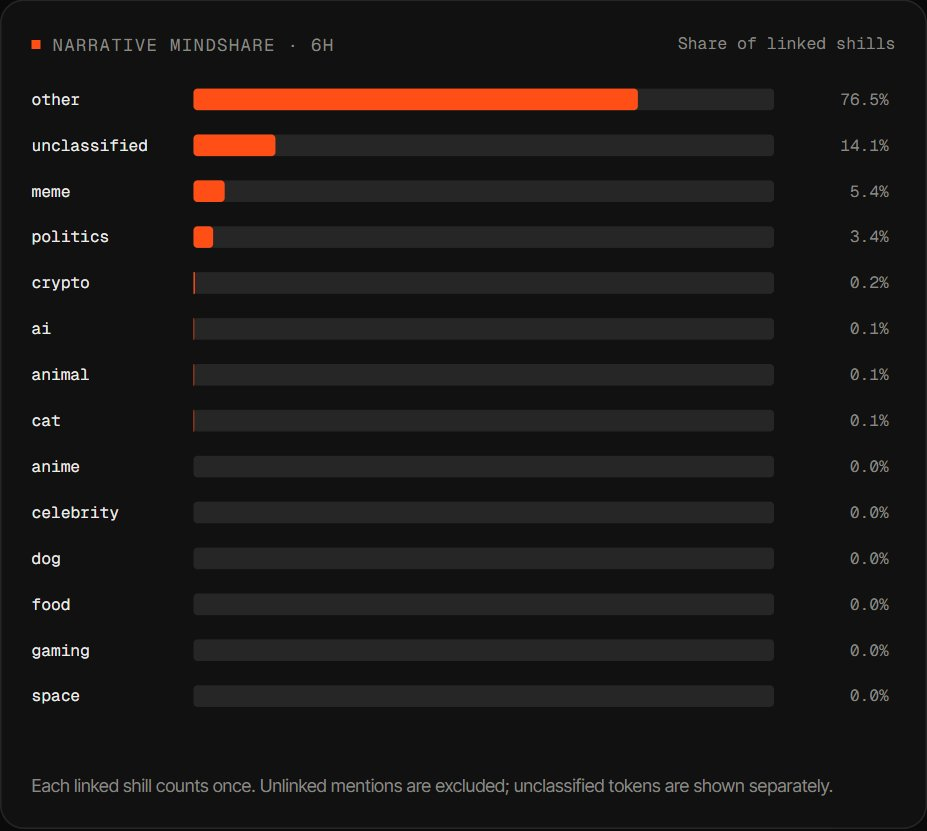

# Dashboard analytics

Panels from the open dashboard at [xkairos.io/app](https://xkairos.io/app), captured 2026-10-22 from live data. Outcome-based charts (win rate, rug rate) fill in as tokens reach their 24h horizon; at capture time almost all outcomes were still pending, so only collection and activity charts are shown here. Not financial advice.

## Overview ([/app](https://xkairos.io/app))

**Hot narratives · 24h** - share of linked shills per narrative theme. Themes are assigned automatically from token names and tickers with keyword rules; each linked shill counts once, unclassified tokens are shown separately.

**Shills by hour · 48h** - number of CA mentions per hourly bucket (UTC, rolling) over the last two days. Shows when the trench is busy.

**Top shillers · 24h** - who produced the largest share of all mentions. SMARTS is the number of smart followers; CA is the count of distinct contract addresses the shiller has ever mentioned (green below 10, yellow 10-19, red 20 and above).

**Most shilled tokens · 24h** - linked tokens ranked by the number of distinct shillers, with the v2 · 24h outcome from the first mention (pending until the horizon ends).

**Collection** - size of the dataset: tokens and mentions in total and in the last 24 hours, migrated tokens, tracked shillers and synced trade rows.

## Shillers ([/app/shillers](https://xkairos.io/app/shillers))

**Shillers by CA** - how many tracked shillers fall into each bucket of distinct CAs called: fewer than 10, 10-19, 20 or more. A high CA count marks a high-volume caller, the group the CA vs rug-rate comparison on the same page looks at once enough outcomes are final.

## Narratives ([/app/narratives](https://xkairos.io/app/narratives))

**Narrative mindshare · 6h** - the same share-of-linked-shills measure for every theme (meme, politics, crypto, AI, animals and more) over a 6-hour window; the page also offers 24h.
