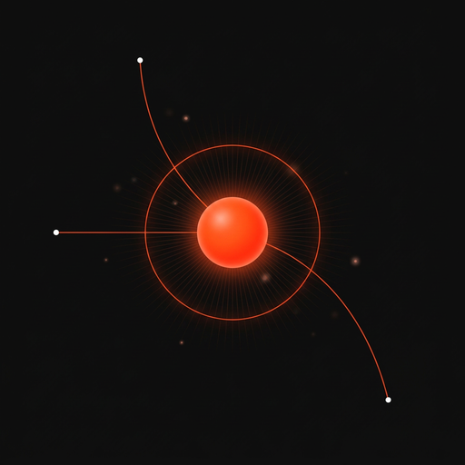

# Brand assets

| File | Size | Use |
| --- | --- | --- |
| [banner.jpg](banner.jpg) | 1600×679 | README header |
| [social-preview.jpg](social-preview.jpg) | 1280×640 | GitHub social preview (Settings → Social preview), link cards |
| [logo.png](logo.png) | 512×512 | Avatar, app icon |
| [logo-160.png](logo-160.png) | 160×160 | Small icon |

Palette: background `#0A0A0A`, accent orange `#FF4F17`, win green, rug red, muted grey text. Fonts on the site: Inter Tight for text, Geist Mono for data and labels.

The images were generated with Nano Banana Pro from a prompt describing the landing page's hero scene (shiller clusters converging on one token).
