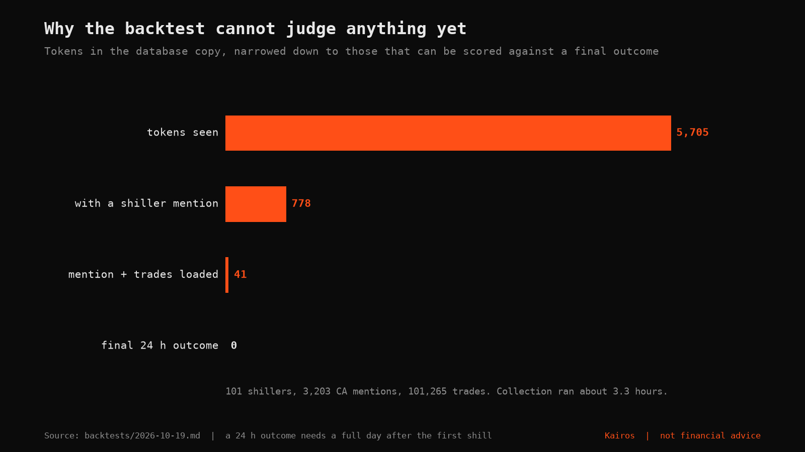
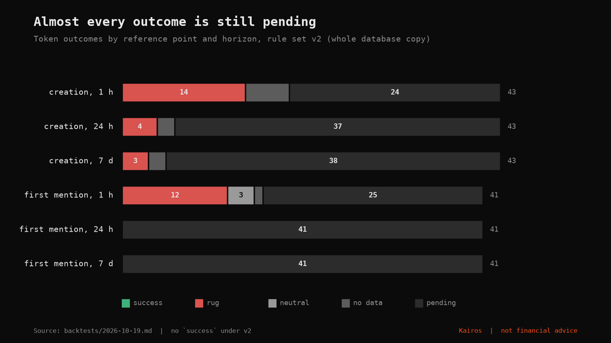
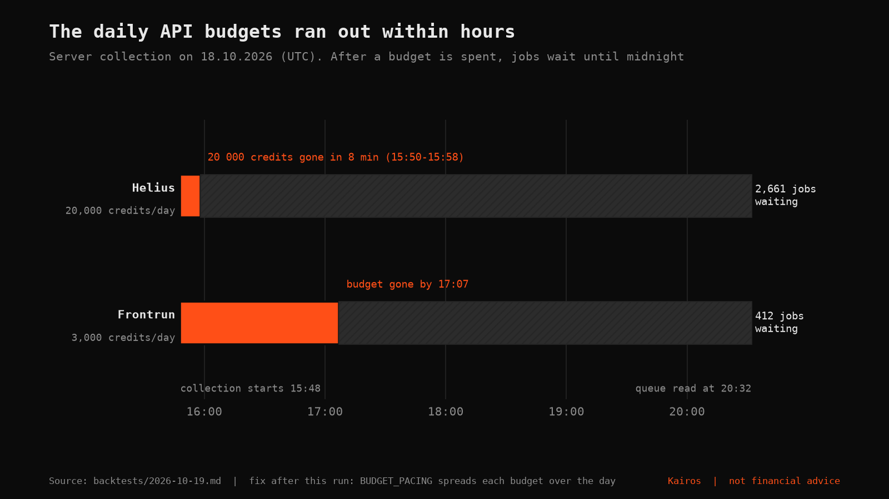
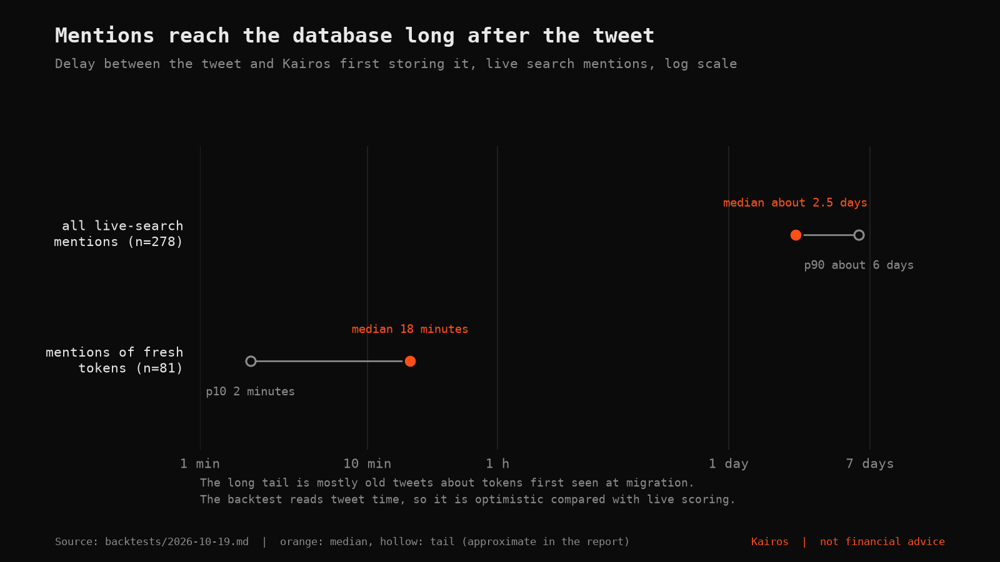
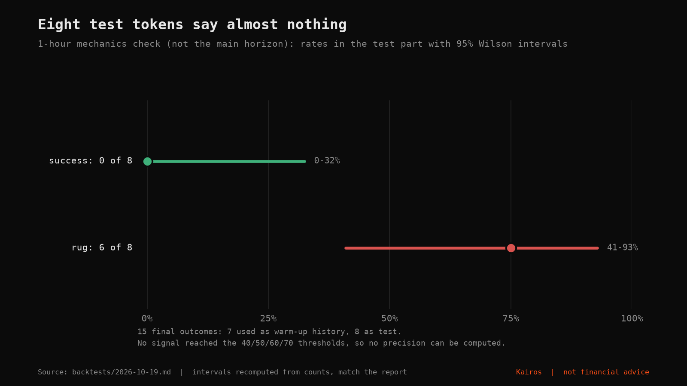

# Backtests

Walk-forward backtests of the s1 scoring formula ([`docs/signals.md`](../docs/signals.md)). Each report is a dated file in this folder.

| Report | Data | Verdict |
| --- | --- | --- |
| [2026-10-19](2026-10-19.md) (in Russian) | Copy of the production database, 18.10.2026, about 3.3 hours of collection | **Scoring cannot be validated yet.** The mechanism works and is tested on synthetic data, but the copy contains no token with a final 24-hour outcome measured from the first shill |

The first run is deliberately published as it is: the honest result is "not enough data", not a precision number. The conclusions below come only from the figures in the report; the charts are drawn by [`scripts/plot_backtest.py`](../scripts/plot_backtest.py), which holds those numbers at the top of the file with a pointer to the section of the report each came from.

> **Not financial advice.** Kairos shows data and statistics about past behaviour. Nothing here predicts a price or recommends buying or selling a token.

## What the first run showed

### 1. There was nothing to score against yet



5,705 tokens were seen, 778 had a shiller mention, only 41 of those had their trades loaded, and none had a final 24-hour outcome. A 24-hour outcome appears a full day after the first shill and only if the token's trades were downloaded. The run therefore reports a test population of 0 and says so.

### 2. Almost every label is still `pending`



Under rule set v2 the labels that exist are mostly `rug` on short horizons (from creation, 14 of 43 at one hour). Everything measured from the first mention at 24 hours and 7 days is `pending`. Those `rug` counts are not a base rate for the market: the sample is small and the labelled tokens are only those whose trades were loaded before the budgets ran out. The v2 rules also relabelled three tokens that v1 had called `success` or `neutral` into `rug` (peaks of x77, x196 and x1,680, then a drop of more than 90% within 30 minutes). Those are the pump-and-dumps v2 was written to catch. One question stays open: the first two still ended above x5 from creation.

### 3. The API budgets ran out in the first hours



The whole daily Helius budget (20,000 credits) was spent between 15:50 and 15:58 UTC, and the Frontrun budget (3,000) by 17:07. At 20:32 UTC the queue held 2,661 Helius and 412 Frontrun jobs, all deferred to midnight UTC. After this run the pipeline got `BUDGET_PACING`, which spends each budget evenly across the UTC day.

### 4. Mentions arrive late, and the backtest does not see that



For live-search mentions the median gap between the tweet and the moment Kairos stored it was about 2.5 days, and the 90th percentile about 6 days. Almost all of that is old tweets about tokens the collector first saw at migration. For mentions of fresh tokens the median is 18 minutes. A backtest reads the tweet's own time, so it sees shills earlier than live scoring does: its results are optimistic, and the report says so.

### 5. A one-hour mechanics check cannot support any claim



To exercise the machinery, the same run was repeated on a one-hour horizon (not the main horizon): 15 final outcomes, 7 used as warm-up history and 8 as test. No test token was a `success` (95% Wilson interval 0 to 32%) and 6 of 8 were `rug` (41 to 93%). No signal passed the 40, 50, 60 or 70 thresholds with `medium` or `high` confidence, so no precision exists. All scores were low and all confidence `low`: shillers have no history yet, which is the designed behaviour.

## What a real backtest needs

- At least 300 to 500 tokens with a final label and 30 or more signals above the threshold. The report estimates one to two weeks of collection at the new budgets (roughly 100 to 150 tokens a day with trades loaded).
- Then: choose the lowest threshold where precision is at least 3 times the base success rate with 30 or more signals, and decide whether `entry` and `similar` should get weights.
- Method caveats stated in the report: the label is measured from the first shill while the score uses data at first shill plus 10 minutes (slightly optimistic); the base rate in the report is taken over the whole test part, not at each signal's time (a review note, not yet fixed); all shiller and creator statistics are recomputed at each token's evaluation time, with no look-ahead, and tests cover this.

## Reproduce

```bash
# a new report from a fresh copy of the database
cd backend && python -m kairos.backtest --rule-version v2 --horizon 24h --delay-min 10 --out ../backtests/<date>.md

# redraw the charts (reads the numbers at the top of the script)
pip install matplotlib
python scripts/plot_backtest.py
```

When a new report is added, update the constants at the top of `scripts/plot_backtest.py` from it.
