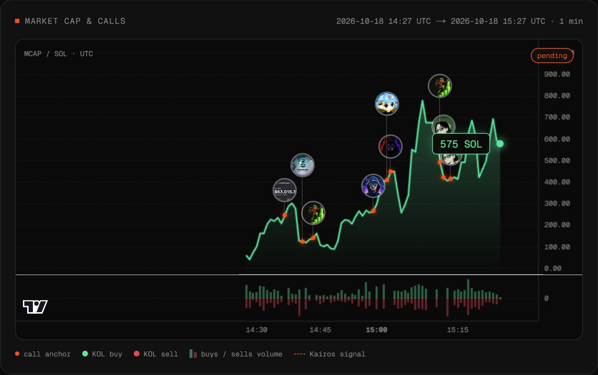
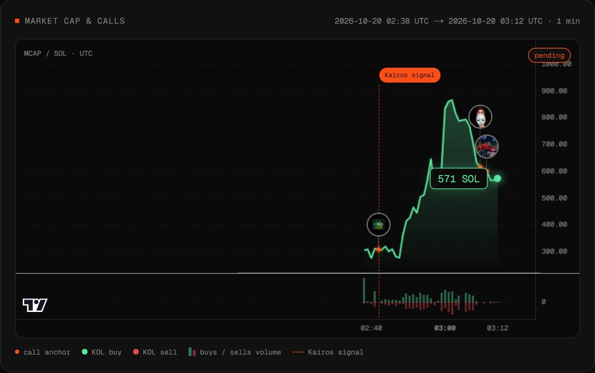
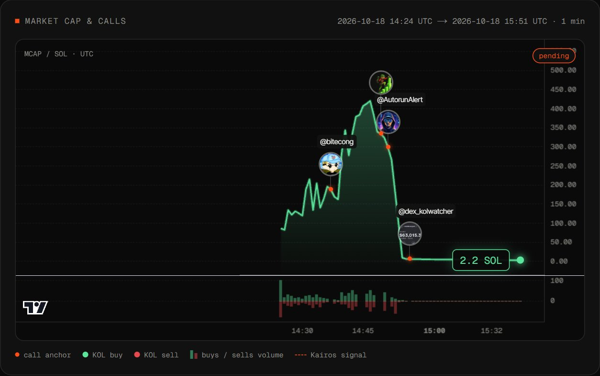
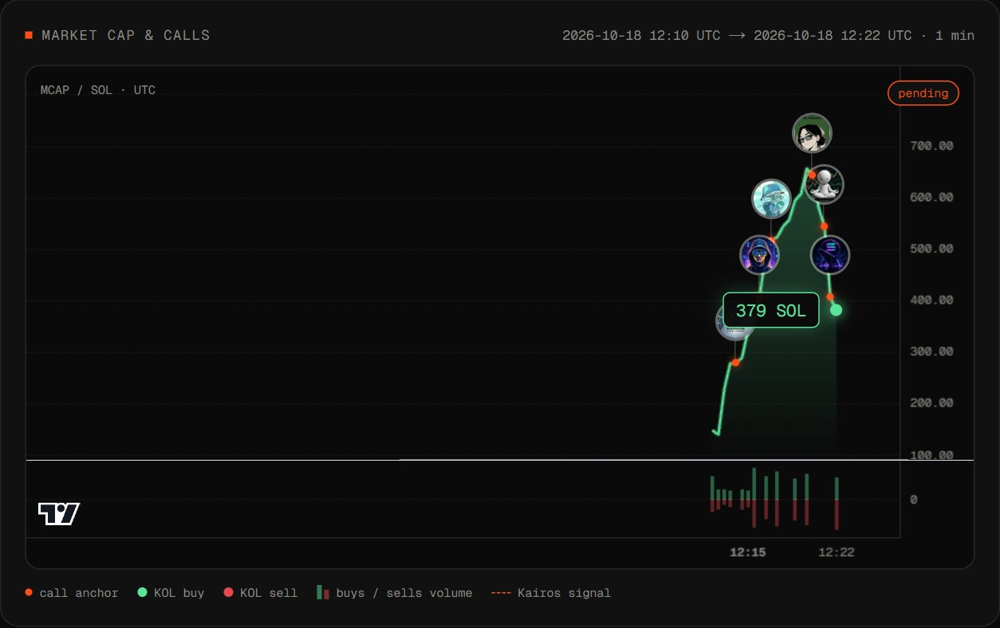
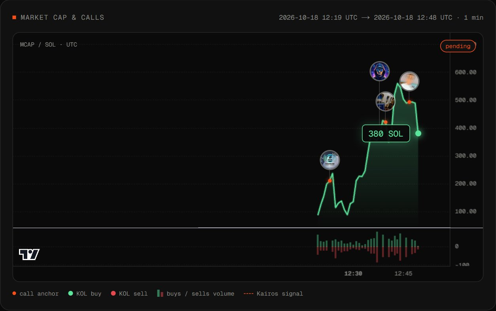
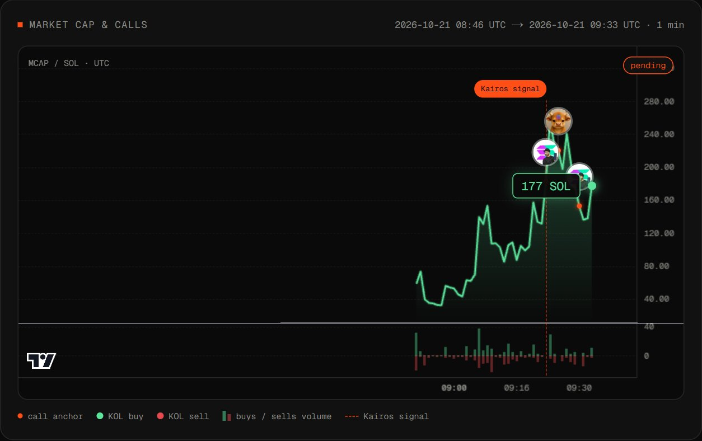
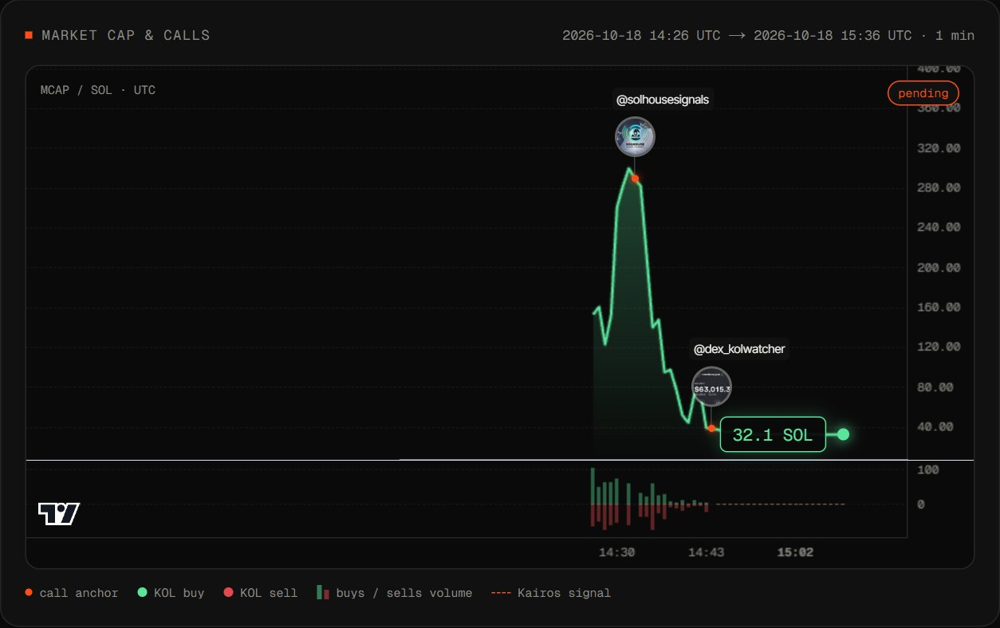
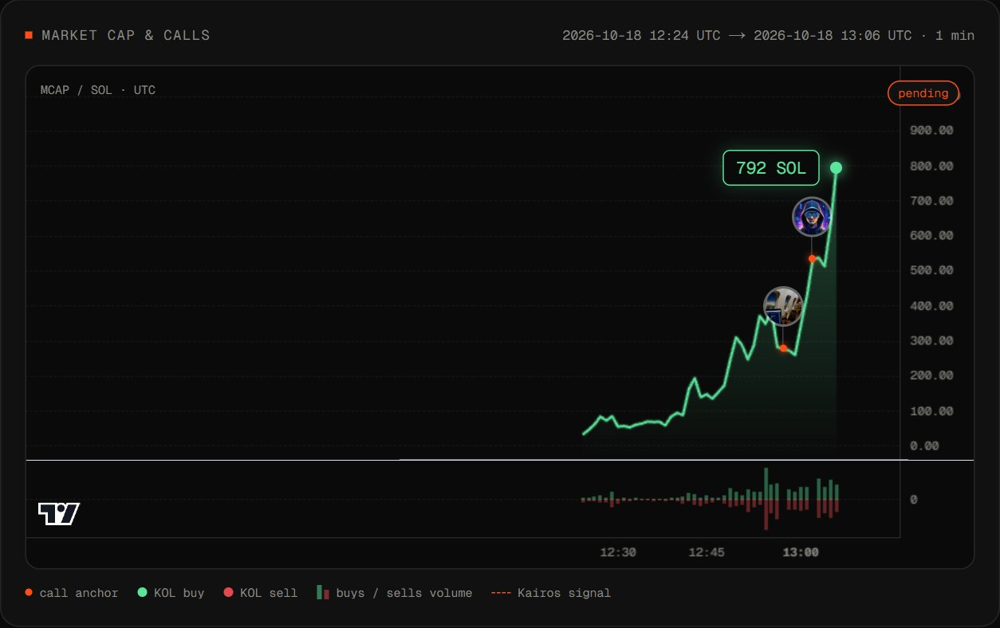

# Calls on the chart

Real tokens from the live dashboard, captured 2026-10-22. Not financial advice.

Each image is the "Market cap & calls" card of a token page. How to read it:

- the line is the token market cap in SOL (1-minute resolution);
- every avatar is a shiller posting the contract address (CA), pinned to the minute of the post;
- the dashed vertical line is the Kairos signal, when the scorer fired (shown only when the token was scored);
- the bars below are buys (green) and sells (red) volume;
- peak multiple = highest market cap after the first call divided by the market cap at the first call.

**VPEUUB...DKPUMP** (unnamed pump.fun token) - 7 shillers, first call at minute 10, peak x3.2 (245 to 777 SOL). One of the busiest charts: a call every few minutes for an hour. [Open the token page](https://xkairos.io/app/tokens/102)

## More examples

| | |
| --- | --- |
|  |  |
| **TWYNE** - 45 shillers, first call at minute 4, peak x2.8 (306 to 865 SOL), Kairos signal marker. [Token page](https://xkairos.io/app/tokens/47106) | **5GYTAC...1QPUMP** - 6 shillers, first call at minute 13, peak x2.2 (187 to 420 SOL), then a collapse to about 2 SOL (-99%). [Token page](https://xkairos.io/app/tokens/79) |
|  |  |
| **HHBDS3...DTPUMP** - 9 shillers, first call at minute 3, peak x2.4 (278 to 656 SOL), now +36% from the first call. [Token page](https://xkairos.io/app/tokens/99) | **8DATXR...JZPUMP** - 7 shillers, first call at minute 3, peak x2.7 (210 to 559 SOL), now +81% from the first call. [Token page](https://xkairos.io/app/tokens/88) |
|  |  |
| **DREAM** - 16 shillers, first call at minute 37, peak x1.4 (182 to 259 SOL), volatile, Kairos signal marker. [Token page](https://xkairos.io/app/tokens/80846) | **SCHOOLBOOKS** - 3 shillers, first call at minute 5, peak only x1.1 (282 to 299 SOL), then a dump of -89%. [Token page](https://xkairos.io/app/tokens/262) |
|  | |
| **6VWKHV...JIPUMP** - 14 shillers, first call at minute 34, peak x2.9 (276 to 792 SOL), still at its high. [Token page](https://xkairos.io/app/tokens/83) | |

Minutes are counted from token creation. Peak multiples, shiller counts and prices are the values shown on each token page at capture time; they can change as the page updates. The white horizontal line between the price and volume panes is part of the chart rendering.
