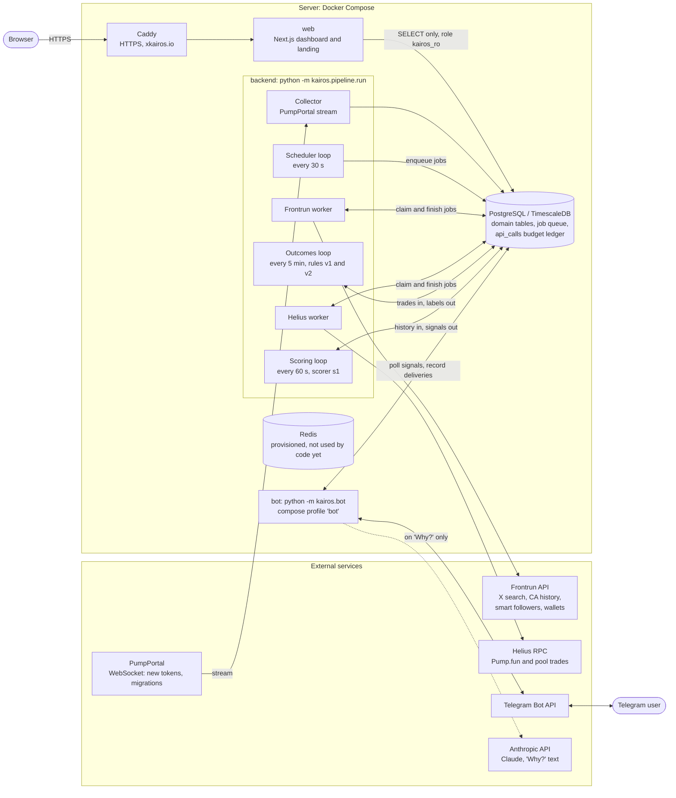

# Architecture

Everything runs on one ARM server with Docker Compose ([`deploy/docker-compose.yml`](../deploy/docker-compose.yml)). The backend is a single Python asyncio process; Postgres is both the data store and the job queue. External services are called from workers that spend a daily credit budget.

## Components

| Component | Where | What it does |
| --- | --- | --- |
| Collector | [`kairos/collectors/pumpportal.py`](../backend/kairos/collectors/pumpportal.py) | One WebSocket connection to PumpPortal (`subscribeNewToken`, `subscribeMigration`); stores tokens, creator wallets and a first market-cap snapshot. `created_at` is the receive time, because events carry no block time. |
| Scheduler | [`kairos/pipeline/scheduler.py`](../backend/kairos/pipeline/scheduler.py), `helius_tasks.py`, `kol_wallets.py` | Every 30 s: queue a CA search for every migrated token (priority 10) and for a 5% hash-based sample of new tokens, 5 minutes after creation (priority 1); queue Helius trade backfills at each outcome checkpoint; queue smart-follower and wallet lookups; link late mentions to tokens; classify the narrative from name and ticker. |
| Job queue and budgets | [`kairos/pipeline/jobs.py`](../backend/kairos/pipeline/jobs.py), `budget.py` | A `jobs` table (one row per `(kind, key)`) in Postgres, claimed with row locks. Daily credit budgets for Frontrun (3000) and Helius (20000) are counted from the `api_calls` table and spent evenly across the UTC day. |
| Frontrun worker | [`kairos/pipeline/frontrun_tasks.py`](../backend/kairos/pipeline/frontrun_tasks.py) | Searches X for a contract address, stores authors as `kols` and tweets as `mentions`; authors with at least 1000 followers become tracked and get a CA-history job. Also smart-follower counts and wallet discovery. |
| Helius worker | [`kairos/pipeline/helius_tasks.py`](../backend/kairos/pipeline/helius_tasks.py), [`kairos/collectors/helius_trades.py`](../backend/kairos/collectors/helius_trades.py) | Downloads a token's trades up to a checkpoint (`creation` or `first_mention` plus 1 h / 24 h / 7 d plus 5 min), advances `tokens.trades_synced_until` and recomputes outcomes. Also polls tracked shiller wallets hourly. |
| Outcomes | [`kairos/outcomes.py`](../backend/kairos/outcomes.py) | Labels each token `success`, `rug`, `dead`, `neutral`, `pending` or `no_data` per horizon and reference. See [outcomes.md](outcomes.md) and [`docs/outcomes.md`](../docs/outcomes.md). |
| Scoring | [`kairos/scoring.py`](../backend/kairos/scoring.py) | Rule-based score 0-100 and a confidence level from shiller track records known at evaluation time. See [`docs/signals.md`](../docs/signals.md). |
| Bot | [`kairos/bot/`](../backend/kairos/bot) | Separate container, same image. Polls `signals` every 20 s, sends those at or above each subscriber's threshold with `medium` or `high` confidence, once per chat. `Why?` calls [`kairos/explain.py`](../backend/kairos/explain.py), which asks Claude to explain the facts (cached in `signal_explanations`); the LLM never sets the score. |
| Web | [`web/`](../web) | Next.js 16 app behind Caddy. Reads Postgres through a read-only role; no write path. |
| Caddy | [`deploy/Caddyfile`](../deploy/Caddyfile) | Automatic Let's Encrypt certificates and reverse proxy to `web:3000`. Only ports 80 and 443 are published; Postgres, Redis and the web container are not. |

## Notes

- The Helius worker and the outcomes loop start only when `HELIUS_API_KEY` is set; without it the pipeline still collects tokens and tweets.
- Redis is in the Compose file and `REDIS_URL` is passed to the backend, but the code does not use it yet. The queue is Postgres. It is drawn without connections for that reason.
- TimescaleDB is optional: migration `0001` turns `trades` and `token_snapshots` into hypertables when the extension exists and otherwise leaves ordinary tables.
