# Data model

The main tables of the Postgres schema ([`backend/migrations/`](../backend/migrations), 13 migrations). Columns shown are the ones that carry meaning; bookkeeping columns are omitted. Field-level descriptions are in the [JSON Schemas](../schemas).

```mermaid
erDiagram
    kols {
        bigint id PK
        text twitter_id UK "stable X id, handles change"
        text username
        int followers_count
        int smart_followers_count
        bool tracked "passed follower threshold"
        timestamptz last_mention_at
    }
    wallets {
        bigint id PK
        text chain
        text address UK "unique with chain"
        timestamptz kol_trades_synced_until
    }
    kol_wallets {
        bigint kol_id PK, FK
        bigint wallet_id PK, FK
        text relation PK "associated, mentioned, fomo, manual"
    }
    tokens {
        bigint id PK
        text mint UK "unique with chain"
        text symbol
        bigint creator_wallet_id FK
        timestamptz created_at "receive time"
        timestamptz migrated_at
        timestamptz trades_synced_until "trades loaded up to"
        text narrative
    }
    mentions {
        bigint id PK
        bigint kol_id FK
        bigint token_id FK "null until the token is known"
        text ca "address as tweeted"
        text tweet_id UK "unique with ca"
        timestamptz tweet_time
        text source "frontrun_search, frontrun_ca_history"
    }
    trades {
        timestamptz ts PK
        text signature PK
        bigint token_id PK, FK
        text side "buy, sell"
        numeric sol_amount
        numeric market_cap_sol
    }
    token_snapshots {
        timestamptz ts PK
        bigint token_id PK, FK
        numeric market_cap_sol
        numeric liquidity_sol
    }
    token_outcomes {
        bigint token_id PK, FK
        interval horizon PK "1 hour, 24 hours, 7 days"
        text rule_version PK "v1, v2"
        text reference PK "creation, first_mention"
        text label "success, rug, dead, neutral, pending, no_data"
        numeric peak_multiple
        numeric end_multiple
        jsonb metrics
    }
    signals {
        bigint id PK
        bigint token_id FK "unique with scorer_version"
        numeric score "0 to 100"
        text confidence "low, medium, high"
        text scorer_version
        jsonb features
        int n_shillers
        timestamptz first_mention_at
    }
    signal_explanations {
        bigint signal_id PK, FK
        text facts_hash PK
        text model
        text text "LLM wording of the facts"
    }
    kol_trades {
        text signature PK
        bigint wallet_id PK, FK
        text mint PK
        bigint kol_id FK
        bigint token_id FK "may be null"
        timestamptz ts
        text side "buy, sell"
    }
    bot_subscribers {
        bigint chat_id PK
        int threshold "0 to 100"
        bool paused
        bool active
    }
    bot_muted_kols {
        bigint chat_id PK, FK
        bigint kol_id PK, FK
    }
    signal_deliveries {
        bigint signal_id PK, FK
        bigint chat_id PK, FK
        timestamptz sent_at
        bigint message_id
    }

    kols ||--o{ mentions : "posts"
    tokens |o--o{ mentions : "is mentioned in"
    wallets |o--o{ tokens : "created by"
    kols ||--o{ kol_wallets : "linked to"
    wallets ||--o{ kol_wallets : "linked to"
    tokens ||--o{ trades : "has"
    tokens ||--o{ token_snapshots : "has"
    tokens ||--o{ token_outcomes : "labelled by"
    tokens ||--o{ signals : "scored as"
    signals ||--o{ signal_explanations : "explained by"
    signals ||--o{ signal_deliveries : "sent as"
    bot_subscribers ||--o{ signal_deliveries : "receives"
    bot_subscribers ||--o{ bot_muted_kols : "mutes"
    kols ||--o{ bot_muted_kols : "muted by"
    wallets ||--o{ kol_trades : "trades"
    kols ||--o{ kol_trades : "makes"
    tokens |o--o{ kol_trades : "in"
```

## Tables not drawn

| Table or view | Purpose |
| --- | --- |
| `jobs` | Work queue in Postgres: one row per `(kind, key)`, status `pending`, `running`, `done`, `failed` or `skipped`, claimed with `FOR UPDATE SKIP LOCKED` (migration `0002`). |
| `api_calls` | Ledger of paid API calls (`frontrun`, `helius`, `llm`) with credits per call. The daily credit budgets are computed from it. |
| `kol_username_history` | Past handles of a shiller, because a handle can pass to another account. |
| `raw_events` | Raw source payloads kept for reprocessing and debugging. |
| `kol_positions`, `kol_hold_stats` | Views over `kol_trades` (migration `0012`): a position is one wallet and one mint, from the first buy to the first sell after it. Hold time, median hold and the share of positions closed in under 60 seconds feed the on-chain part of scoring. |

## Things worth knowing

- **Why `mentions.token_id` can be null.** A tweet can name a contract address before the collector has seen the token. `ca` keeps the address as tweeted; the scheduler fills `token_id` once the token exists.
- **Outcomes are versioned.** The primary key of `token_outcomes` includes `rule_version`, so v1 and v2 rows sit side by side and backtests can compare them.
- **One signal per token and scorer.** `signals` has a unique index on `(token_id, scorer_version)`; later evaluations update the row.
- **Time series.** `trades` and `token_snapshots` become TimescaleDB hypertables when the extension is available; otherwise they stay ordinary tables.
- **Read-only access.** The dashboard connects as the role `kairos_ro` (SELECT only).
