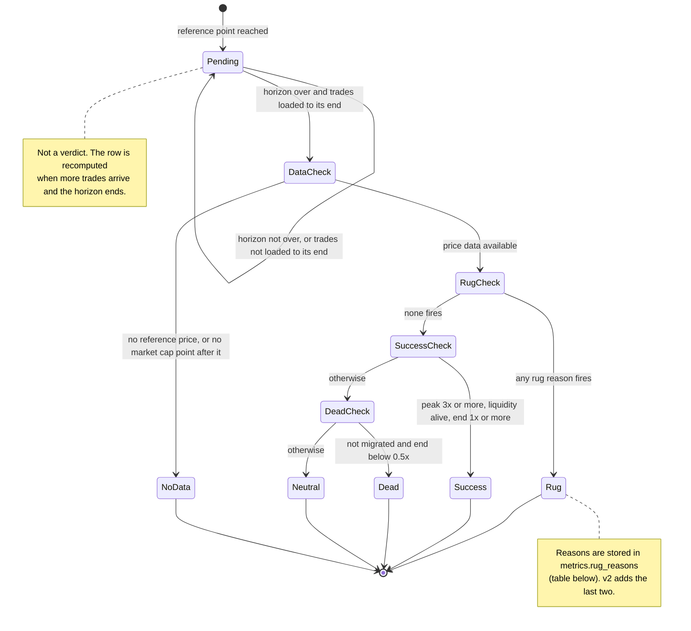

# Outcome labels

How a token gets its label for one horizon (1 hour, 24 hours or 7 days) and one reference point (`creation` or `first_mention`). The checks run in a fixed order and the first match wins. Rules and thresholds: [`docs/outcomes.md`](../docs/outcomes.md); code: [`kairos/outcomes.py`](../backend/kairos/outcomes.py), function `label_outcome`.

## Rug reasons

Any one is enough. They are all recorded, not only the first.

| Reason | Fires when | Rules |
| --- | --- | --- |
| `liquidity_crash` | Real liquidity falls by more than 80% between two points at most 10 minutes apart | v1, v2 |
| `creator_sold` | The creator wallet sold more than 50% of its tokens within one hour of the reference point. Not evaluated if the creator's holdings are unknown | v1, v2 |
| `collapse` | End market cap below 0.1x the reference and a drawdown from the peak above 90% | v1, v2 |
| `fast_dump` | Market cap falls by more than 90% between two points at most 30 minutes apart | v2 |
| `pump_and_dump` | A peak of at least 3x the reference, then within 30 minutes the market cap is back to the reference plus at most 10% of the gain | v2 |

## Reading the diagram

- **Pending is the default.** A horizon is judged only when it is over and `tokens.trades_synced_until` covers its end; otherwise the row says `pending` with `metrics.pending_reason` of `horizon_not_finished` or `data_incomplete`. Hence the large `pending` counts in early data, and why `no_data` is never set before the horizon ends.
- **`success` needs known liquidity.** If liquidity on the horizon is unknown, `liquidity_alive` is null and the token cannot be a success.
- **Two references.** `creation` asks what usually happens to this creator's tokens. `first_mention` asks whether it was worth looking when the shiller posted. Scoring uses `first_mention` for shillers and `creation` for creators.
- **Versions side by side.** The primary key includes `rule_version`; v1 and v2 rows coexist so backtests can compare them. The scorer reads `v2` by default.
- **Known weaknesses of v1** (documented in `docs/outcomes.md`): from `creation`, a pump-and-dump back to the bottom of the curve ends near 1x and looks `neutral`; the liquidity-crash rule is strict. v2 addresses both through `pump_and_dump` and `fast_dump`.
