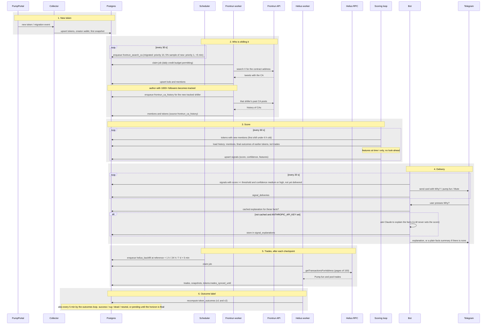

# Pipeline: from a new token to a Telegram message

The sequence for one token. Steps 1-4 take minutes: the token is scored and, if the score and the evidence are high enough, delivered. Steps 5 and 6 come later: trades are downloaded after each outcome checkpoint (the reference moment plus 1 h, 24 h or 7 d, plus 5 minutes) and only then is the outcome label final. A token's own outcome therefore never reaches its own score; outcomes of earlier tokens are what shiller track records are made of.

## Details that matter

- **Search is sampled.** About 13 new tokens appear per minute and a search costs 2 Frontrun credits, so searching everything would cost around 37 000 credits a day against a budget of 3000. All migrated tokens are searched; of new tokens, 5% by a hash of the mint.
- **Time of the signal.** A token is scored while its first shill is younger than `SIGNAL_MAX_AGE_HOURS` (6). `signals` has one row per token and scorer version, updated as more shillers appear (or shiller wallets trade it).
- **What the score reads.** Final outcomes of other tokens (24 h, from first mention) are the shillers' track records; the creator's earlier tokens use the `creation` reference. A past token counts only if its horizon had ended by the evaluation time. See [`docs/signals.md`](../docs/signals.md).
- **Shiller wallets.** In parallel, wallets linked to top shillers are found through Frontrun and polled through Helius; their trades feed the `onchain` fields (holding, quick dumps, selling after a call). Not drawn above to keep the main path readable.
- **Delivery limits.** Each signal goes to a chat once, at most 20 per chat per pass; shillers a subscriber muted are skipped, and a signal is not sent if all of its shillers are muted.
