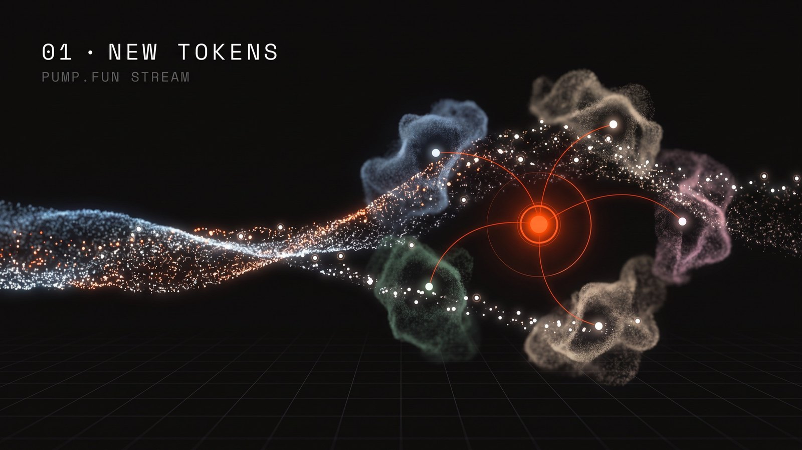
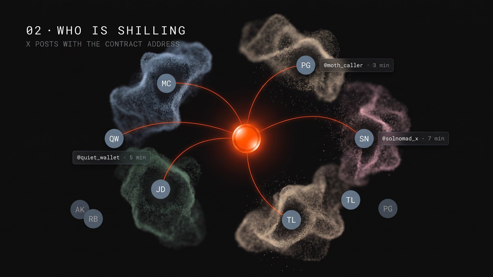
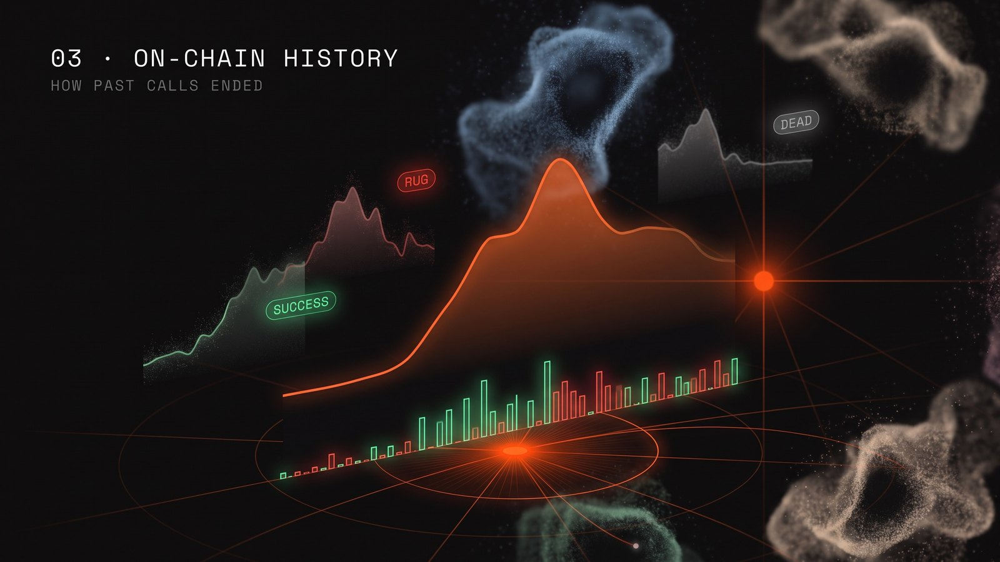
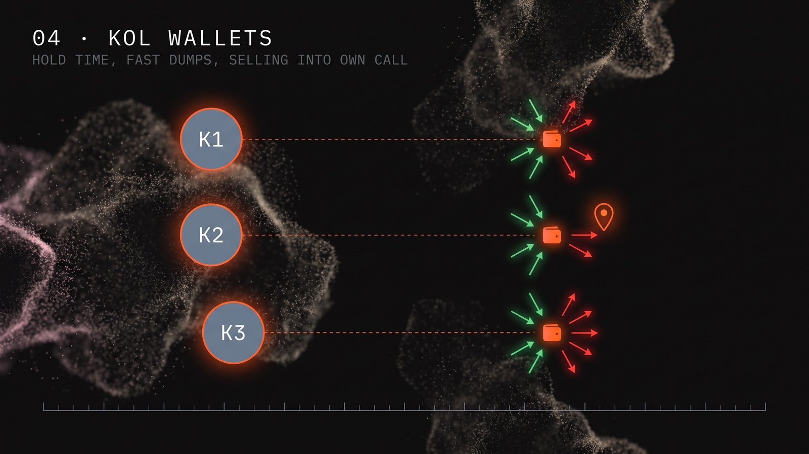
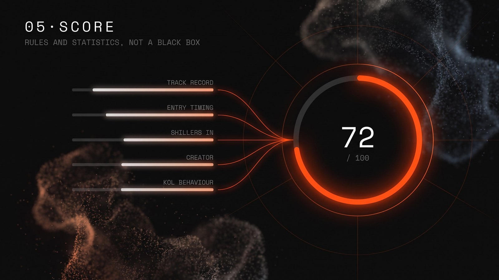
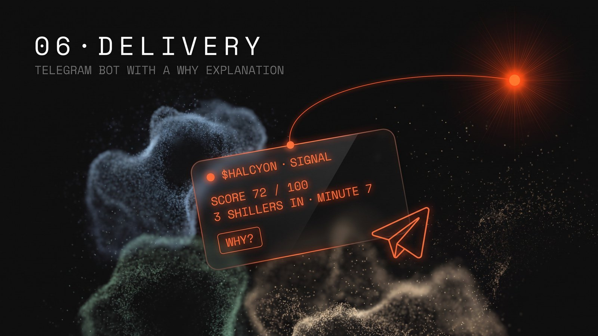

# How Kairos works, step by step

Kairos turns a fresh pump.fun token into a scored, explained signal in six steps. The illustrations below are concept art in the style of the site; real data lives in [calls/](../calls), [showcase/](../showcase) and [analytics/](../analytics). The exact rules are in [docs/outcomes.md](../docs/outcomes.md) and [docs/signals.md](../docs/signals.md), and the flow as code-level diagrams is in [diagrams/](../diagrams).

## 01 · New tokens

New pump.fun tokens and migrations stream in for free from PumpPortal. Every token gets a row with its creator wallet, launch time and first market cap, so nothing has to be polled.

## 02 · Who is shilling

For each token Kairos searches X for its contract address through the [Frontrun](https://frontrun.pro) API. Every author who posts the CA becomes a tracked shiller with followers, smart followers (SMARTS) and the number of distinct CAs they have posted. The minute of each call is kept, because being early is what matters.

## 03 · On-chain history

Trades come from Helius. From the price path after the first shill, every past token gets an outcome label: success, rug, dead or neutral. This is how Kairos knows how a shiller's previous calls actually ended, not how they were advertised.

## 04 · KOL wallets

Wallets linked to shillers are polled for their own trades. That gives median hold time, fast dumps, and the worst pattern of all: selling into one's own call.

## 05 · Score

The score is rules and statistics, not a black box: each shiller's track record (Wilson lower bound of the win rate), how early the entry was, how many shillers are already in, the creator's history and KOL on-chain behaviour. Every risk is listed next to the number.

## 06 · Delivery

A Telegram bot sends signals above each user's threshold. The "Why?" button opens a short explanation written by Claude from the signal's facts. The LLM explains, it never sets the score.

> Not financial advice. Kairos shows data and statistics about past behaviour; it does not tell anyone what to buy.
